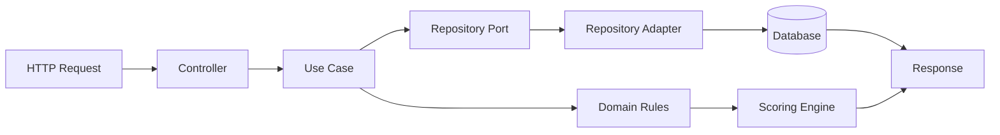
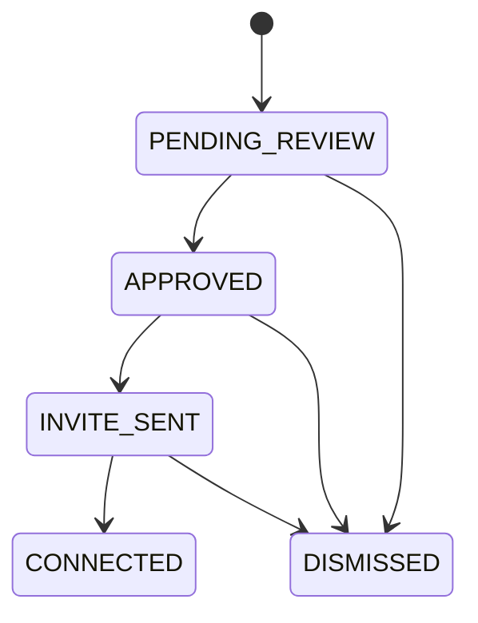

<div align="center">

# TalentBridge

### Construindo pontes entre talentos e oportunidades.


</div>

---

## 1. Descricao do produto

O **TalentBridge** e uma plataforma para profissionais de tecnologia que desejam organizar networking com recrutadores, acompanhar o progresso de relacionamento e priorizar oportunidades com base em **relevancia calculada dinamicamente**.

A aplicacao permite:
- cadastrar recrutadores
- configurar perfil profissional personalizado
- definir objetivos de carreira
- cadastrar skills com pesos
- recalcular score de relevancia dos recrutadores com base no perfil ativo

> Importante: o sistema **nao automatiza acoes no LinkedIn** (nao envia convites automaticamente e nao executa automacoes externas na plataforma).

---

## 2. Principais funcionalidades

- Gestao de recrutadores
- Gestao de palavras-chave
- Perfil profissional configuravel
- Skills com pesos personalizados
- Objetivos de carreira
- Engine de score dinamica
- Recalculo de relevancia de recrutadores
- Pipeline de relacionamento com recrutadores
- API REST documentada
- Migrations com Flyway
- Observabilidade e logs estruturados

---

## 3. Arquitetura

O projeto segue padroes corporativos modernos:

- **Clean Architecture**
- **Domain-Driven Design (DDD)**
- **SOLID**
- **Ports & Adapters (Hexagonal Architecture)**

### Responsabilidades por camada

- **application**: casos de uso, DTOs, portas de entrada e saida
- **domain**: entidades, regras de negocio, servicos de dominio
- **infrastructure**: persistencia, configuracoes, scheduler, componentes tecnicos
- **interfaces**: controllers REST e tratamento global de excecoes
- **shared**: constantes e utilitarios comuns

---

## 4. Estrutura de pacotes

```text
com.dunkweb.talentbridge
├── application
│   ├── dto
│   ├── mapper
│   ├── port
│   │   ├── input
│   │   └── output
│   └── usecase
├── domain
│   ├── entity
│   ├── enums
│   ├── exception
│   ├── service
│   └── valueobject
├── infrastructure
│   ├── configuration
│   ├── external
│   ├── persistence
│   │   ├── entity
│   │   ├── mapper
│   │   └── repository
│   └── scheduler
├── interfaces
│   ├── advice
│   └── controller
└── shared
    ├── constants
    └── util
```

---

## 5. Fluxo de funcionamento da aplicacao



Com observabilidade habilitada, o fluxo acima e rastreado por um unico `requestId` (MDC) do inicio ao fim.

---

## 6. Pipeline de recrutadores



Status utilizados no dominio:
- `PENDING_REVIEW`
- `APPROVED`
- `INVITE_SENT`
- `CONNECTED`
- `DISMISSED`

---

## 7. Pipeline de score dinamico

O usuario define:
- skills
- pesos
- objetivos profissionais

Exemplo de preferencias:
- Java = 10
- AWS = 10
- Spring Boot = 8
- Microservices = 8

Headline do recrutador:

`Hiring Java AWS Engineers for Microservices projects`

Resultado:
- Java = +10
- AWS = +10
- Microservices = +8

**Score final = 28**

A pontuacao e calculada exclusivamente com base nas preferencias do perfil ativo.

---

## 8. Tecnologias utilizadas

- Java 21
- Spring Boot 3
- Spring Web
- Spring Data JPA
- Spring Validation
- Spring Scheduler
- OpenFeign
- PostgreSQL
- H2 Database
- Flyway
- Lombok
- OpenAPI / Swagger (springdoc)
- Docker / Docker Compose
- JUnit 5 / Mockito / AssertJ
- SLF4J / Logback

---

## 9. Como executar localmente

### 9.1 Pre-requisitos

- JDK 21
- Maven 3.9+
- Docker e Docker Compose (opcional)

### 9.2 Executar com Maven (modo padrao H2)

```bash
mvn clean install
mvn spring-boot:run
```

Aplicacao: `http://localhost:8080`

### 9.3 Executar com Docker Compose

```bash
docker compose up --build
```

> Observacao: o `application.yml` atual inicia com H2 em memoria por padrao. O compose ja disponibiliza PostgreSQL para cenarios de evolucao e ambiente containerizado.

---

## 10. Configuracao da aplicacao

Arquivo principal: `src/main/resources/application.yml`

Configuracoes relevantes atuais:

- `spring.datasource.url=jdbc:h2:mem:talentbridge`
- `spring.h2.console.enabled=true`
- `spring.flyway.enabled=true`
- `springdoc.api-docs.path=/openapi`
- `springdoc.swagger-ui.path=/swagger-ui.html`

Exemplo de override para PostgreSQL via variaveis de ambiente:

```bash
set SPRING_DATASOURCE_URL=jdbc:postgresql://localhost:5432/talent_bridge
set SPRING_DATASOURCE_USERNAME=talent_bridge
set SPRING_DATASOURCE_PASSWORD=talent_bridge
mvn spring-boot:run
```

---

## 11. Swagger / OpenAPI

- Swagger UI: `http://localhost:8080/swagger-ui.html`
- OpenAPI JSON: `http://localhost:8080/openapi`

---

## 12. H2 Console

- URL: `http://localhost:8080/h2-console`
- JDBC URL: `jdbc:h2:mem:talentbridge`
- User: `sa`
- Password: *(vazio por padrao)*

---

## 13. Endpoints principais

### Perfil profissional

- `POST /api/profile`
- `GET /api/profile`
- `PUT /api/profile`
- `DELETE /api/profile`

### Recruiters

- `POST /api/recruiters`
- `GET /api/recruiters`
- `GET /api/recruiters/{id}`
- `PUT /api/recruiters/{id}/approve`
- `PUT /api/recruiters/{id}/invite`
- `PUT /api/recruiters/{id}/connect`
- `PUT /api/recruiters/{id}/dismiss`
- `POST /api/recruiters/recalculate-scores`
- `GET /api/recruiters/discovery`

### Keywords

- `POST /api/keywords`
- `GET /api/keywords`
- `GET /api/keywords/{id}`
- `DELETE /api/keywords/{id}`

---

## 14. Banco de dados e migracoes

O projeto utiliza **Flyway** para versionamento de schema.

Migracoes em:
- `src/main/resources/db/migration`

Exemplos atuais:
- criacao de tabelas de recrutadores e keywords
- criacao de tabelas para perfil profissional, skills e objetivos
- indices para consultas frequentes

As migracoes sao aplicadas automaticamente no startup da aplicacao.

---

## 15. Observabilidade e logs estruturados

A aplicacao esta preparada para troubleshooting corporativo e ambientes cloud native.

### Padrao de tags

- `[REQUEST]`
- `[USE_CASE]`
- `[DOMAIN]`
- `[SCORE]`
- `[SCHEDULER]`
- `[ERROR]`

### Correlacao via MDC

O filtro HTTP adiciona automaticamente:
- `requestId`
- `httpMethod`
- `requestPath`

Se o header `X-Request-Id` nao for enviado, um UUID e gerado.

### Formato de log (Logback)

- timestamp
- level
- requestId
- thread
- logger
- mensagem

Exemplo:

```text
2026-10-27 14:00:00.123 INFO  [requestId=123e4567-e89b-12d3-a456-426614174000] [http-nio-8080-exec-1] c.d.t.application.usecase.CreateRecruiterUseCaseImpl - [USE_CASE] Recruiter creation completed recruiterId=... score=28 durationMs=134
```

Base pronta para integracao futura com:
- Grafana + Loki
- OpenTelemetry
- Azure Application Insights
- Elastic Stack
- Datadog

---

## 16. Testes

Executar todos os testes:

```bash
mvn test
```

Executar build completo com testes:

```bash
mvn clean install
```

---

## 17. Roadmap futuro

- Dashboard de acompanhamento
- Metricas de networking
- IA para sugestao de contatos
- Insights de carreira
- Integracao com OpenAI
- Integracao com Azure OpenAI
- Integracao com LinkedIn (apenas assistida, sem automacao invasiva)
- Sistema de follow-up inteligente

---

## 18. Contribuicao

Contribuicoes sao bem-vindas.

Fluxo sugerido:

1. Crie uma branch para sua feature.
2. Implemente com testes e documentacao.
3. Garanta `mvn clean install` sem falhas.
4. Abra PR com descricao clara do problema e da solucao.

Padroes esperados:
- Clean Code
- SOLID
- DDD
- Clean Architecture
- Sem regras de negocio em controllers

---

## 19. Licenca

**Uso corporativo / interno - DunkWeb.**

Caso deseje publicar open source, recomenda-se definir explicitamente uma licenca (ex.: MIT, Apache-2.0) em arquivo dedicado.

---

## 20. Autor

**Vinicius de Souza Duarte**  
**DunkWeb**

---

Se este projeto foi util para voce, considere deixar uma estrela no repositorio ⭐
